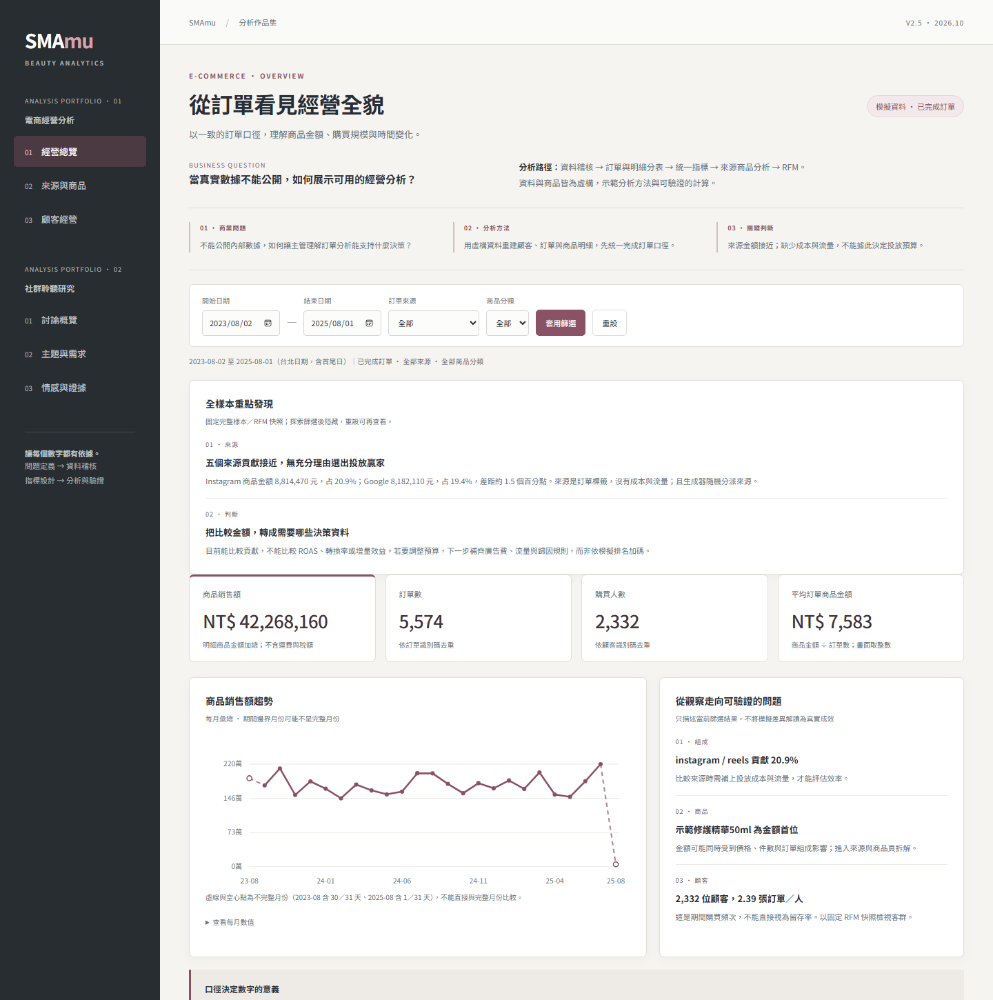
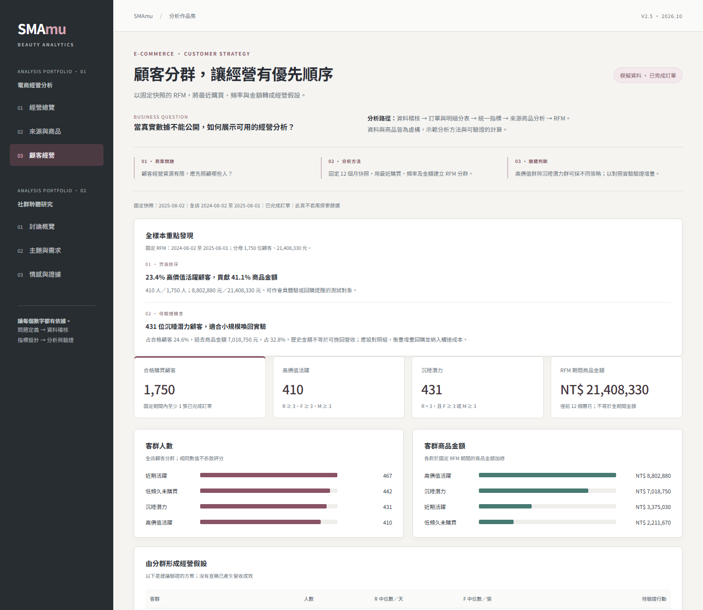
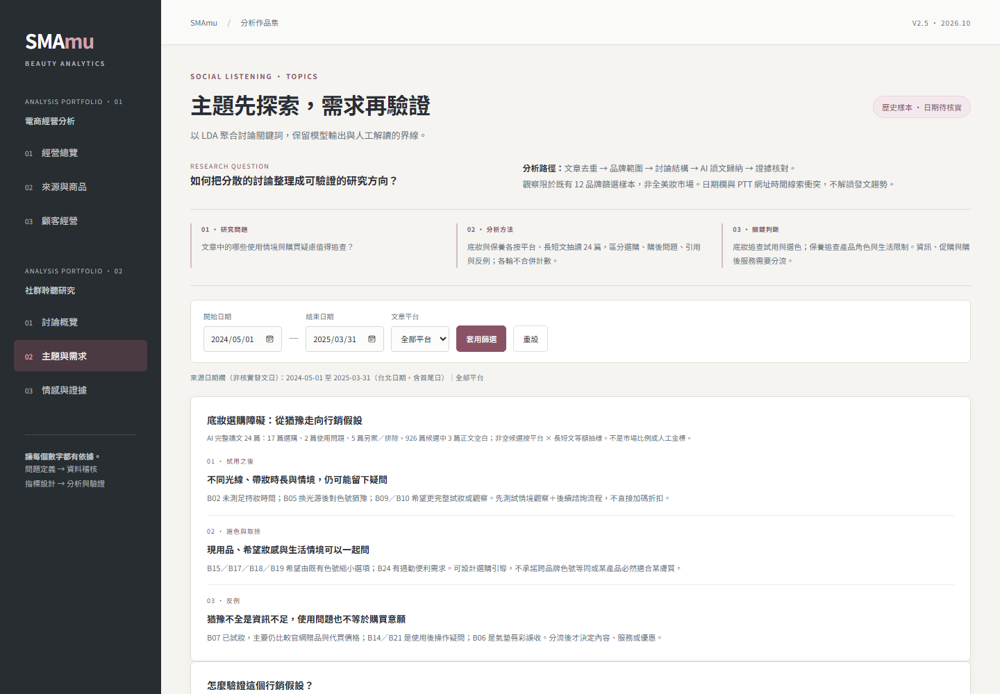

# SMAmu｜商業與資料分析作品集

把商業問題轉成指標、證據與可驗證的行動。兩個案例做成可互動的儀表板：**電商經營分析**與**美妝社群聆聽研究**，各三頁，支援篩選、數值表與摘要 CSV 下載。

**Demo：** https://liangyik.github.io/smamu-analytics-portfolio/ ｜ [English summary](#english-summary)



## 重點摘要

- **電商（虛構資料）：** 5,574 張完成訂單的商品貢獻與 RFM 分群。前三商品占 64.4% 金額、只占 32.3% 件數；拆開單價與數量後，金額集中主要來自高單價，不能直接解讀為需求更強。
- **社群（PTT／Dcard 10,373 篇）：** SnowNLP＋詞典判讀情感、LDA 聚合主題，再針對底妝與保養各完整閱讀 24 篇抽樣文章，整理出可驗證的選購障礙假設，並寫好對應的試驗設計（主指標、分母、護欄、反證）。
- **先檢查資料品質再下結論：** PTT 網址時間與日期欄 5,690／5,690 篇不同日，因此撤下社群月趨勢，不用有疑慮的日期推論成長或季節性。
- **可重現：** 單一 HTML、無需安裝即可離線開啟；19 項回歸測試與一支重算腳本，核對頁面上的關鍵數字。

## 展示的能力

| 能力 | 對應內容 |
|---|---|
| 指標定義 | 顧客、訂單、商品明細分表；訂單與顧客去重；平均訂單商品金額的分母 |
| 顧客分析 | 固定快照的 RFM 四分位分群，轉成經營假設 |
| 文字探勘 | SnowNLP＋詞典情感、LDA 主題（候選 K 以 coherence c_v 比較） |
| 質性研究 | 分層抽樣、逐篇去識別摘要、反例與分流 |
| 實驗設計 | 事先定義主指標、分母、護欄與反證條件的隨機試驗草案 |
| 資料品質 | 日期衝突檢查、未知情感獨立列示、樣本範圍與代表性限制 |
| 前端與工程 | 原生 JavaScript 儀表板、SVG 圖表、CSV 匯出、無障礙設計、Node 自動測試 |

## 案例一：電商經營與顧客策略

**問題：** 內部數據不能公開時，如何示範商品貢獻與顧客經營分析？

使用固定種子產生的虛構商品與交易，先區分顧客、訂單及商品明細，再統一完成訂單的計算口徑。交易期 2023-08-02～2025-08-01，共 5,574 張完成訂單、2,332 位購買顧客、28,144 件商品，商品金額 42,268,160 元。

| 發現 | 判斷與下一步 |
|---|---|
| 前三商品占金額 64.4%，占件數 32.3% | 金額集中需連同單價與數量解讀；選主推商品仍需毛利、庫存與退貨資料 |
| 五個來源各占約 19–21% 商品金額 | 來源由生成器隨機分派，不能宣稱投放效率；需補流量、成本與歸因資料 |
| 高價值活躍群占 23.4% 人數、41.1% 金額 | 可測試會員體驗與回購提醒；另有 431 位沉睡潛力顧客，適合設計有對照組的喚回實驗 |

RFM 使用 2025-08-02 快照與前 12 個曆月，分母為 1,750 位合格顧客、21,408,330 元。



## 案例二：美妝社群聆聽

**問題：** 如何把跨平台、多品牌的分散文章，整理成可驗證的研究方向？

PTT／Dcard 歷史文章經去重與品牌規則篩選後共 10,373 篇（PTT 5,690、Dcard 4,683），範圍限既有字典涵蓋的 12 個品牌。

- **1,436 篇（13.8%）提及多個研究品牌。** 適合進一步抽取比較對象與理由；但多品牌文也可能是清單，整篇情感不能直接歸給單一品牌。
- **情感：** 可判讀率 99.09%，其中模型判為中性占 68.0%。可判讀率不是準確率；120 筆分層人工覆核樣本已備妥，尚未標註。
- **主題：** LDA 選定 K=5，主題名稱保留為「待人工命名」，不把模型群集直接當成消費需求。



### 深入案例：底妝選購障礙

從 926 篇候選按平台與長短文分層，等額抽 24 篇完整閱讀。AI 分流為 17 篇選購、2 篇使用問題、5 篇另案／排除。

- 試用後仍可能缺少情境證據：光線改變、帶妝時間不足、想看整天妝效。
- 跨產品選色需要現用品與希望妝感的背景。
- 反例：有人已試妝，主要在比較價格與通路；也有文章只需要使用教學。

據此提出「試用後情境觀察＋後續諮詢」試驗草案，主指標為 14 天內完成有效諮詢人數÷全部隨機分派合格顧客。完整紀錄見 [research/base_makeup_notes.md](research/base_makeup_notes.md)。

### 深入案例：保養品選購與購後疑慮

從 322 篇聚焦候選分層抽 24 篇完整閱讀：一般選購 11、購後問題 4、特殊照護 3、回覆補充 3、跨品類／排除 3。

- 產品角色與版本差異不清楚，問題會延伸到買完之後。
- 時間、預算與個人價值觀影響選擇，尋求建議不等於加購機會。
- 購後資訊、不適回報與特殊照護需要不同的服務入口。

據此提出「產品角色說明頁」驗證草案，主指標為事先定義的資訊任務全部答對人數÷全部隨機分派合格訪客。完整紀錄見 [research/skincare_notes.md](research/skincare_notes.md)。

## 方法與限制

- **電商資料為虛構：** 觀察到的差異是生成器設定的結果，不代表真實商機；商品金額不含運費、稅、成本及退貨，不稱淨營收、毛利或 ROAS。
- **社群樣本有範圍：** 限 12 個品牌、既有蒐集規則，不能推廣為全美妝市場；品牌提及不是市占。日期待回源核實，不推論趨勢。
- **AI 讀文是探索：** 分流與摘要由 AI 協助完成，未經人工獨立驗證，不代表市場比例或需求普及率；各輪讀文可能重疊，不合併計數。
- **兩案例沒有串接：** 不能推論社群討論造成銷售變化。
- **試驗尚未執行：** 文中的驗證設計都是草案，未宣稱業績提升。

## 資料與隱私

公開內容只有虛構電商明細、固定 RFM 彙總、社群匿名彙總與關鍵詞。社群原文、文章網址／識別碼、原始 CSV、人工覆核材料與模型檔案都未附上；研究紀錄中的逐篇摘要皆為改寫，不含原文、標題或帳號。

本 repo 可重建 Demo 並重算公開快照的量化發現；原始資料清理、電商資料生成與社群模型訓練的上游材料不在其中。

## 專案結構

| 路徑 | 用途 |
|---|---|
| `docs/index.html` | 建置後的完整 Demo，GitHub Pages 由此發布 |
| `src/` | 頁面範本、樣式、互動、計算函式與展示資料 |
| `scripts/build.py` | 由 `src/` 重建 Demo，只需 Python 標準函式庫 |
| `scripts/analyze_findings.py` | 重算商品集中度、多品牌篇數與 RFM 彙總 |
| `research/` | 兩個深入案例的抽樣方法、逐篇摘要、反例與驗證設計 |
| `tests/` | 訂單去重、分母、篩選、固定 RFM、日期警示與不完整月份等 19 項回歸測試 |
| `assets/` | README 截圖 |

## 本機執行

只看 Demo：直接用瀏覽器開啟 `docs/index.html`。

修改與測試需要 Python 3.9 以上與 Node.js 18 以上，不需額外套件（此版在 Python 3.10／Node.js 24 驗證）：

```bash
python3 scripts/build.py
python3 scripts/analyze_findings.py
node --test tests/*.test.cjs
```

Windows 若沒有 `python3`，改用 `py -3`。

## English summary

SMAmu is a business and data analytics portfolio with two interactive case studies, built as a single self-contained static page (vanilla JavaScript, no dependencies).

- **E-commerce (synthetic data):** product contribution and RFM segmentation over 5,574 completed orders. The top three products make up 64.4% of sales but only 32.3% of units, so the concentration comes from price, not stronger demand. Each finding comes with the extra data a real decision would need.
- **Social listening (10,373 PTT/Dcard posts, 12 beauty brands):** sentiment (SnowNLP plus a lexicon) and LDA topics, followed by close reading of 24 sampled posts each on foundation and skincare purchase questions. Each study ends with a randomized test design that sets the primary metric, denominator and guardrails in advance.
- **Data quality first:** the monthly trend was withdrawn after PTT URL timestamps disagreed with the date field on all 5,690 PTT posts.
- **Reproducible:** 19 regression tests and a script that recomputes the key figures from the public snapshot.

The e-commerce data is fictional. Social findings are exploratory, AI-assisted and not yet human-validated, and no raw posts or identifiers are published.

## AI 協助說明

開發、資料修正與初步讀文有 AI 協助；未宣稱營運實績或人工標註準確率。
